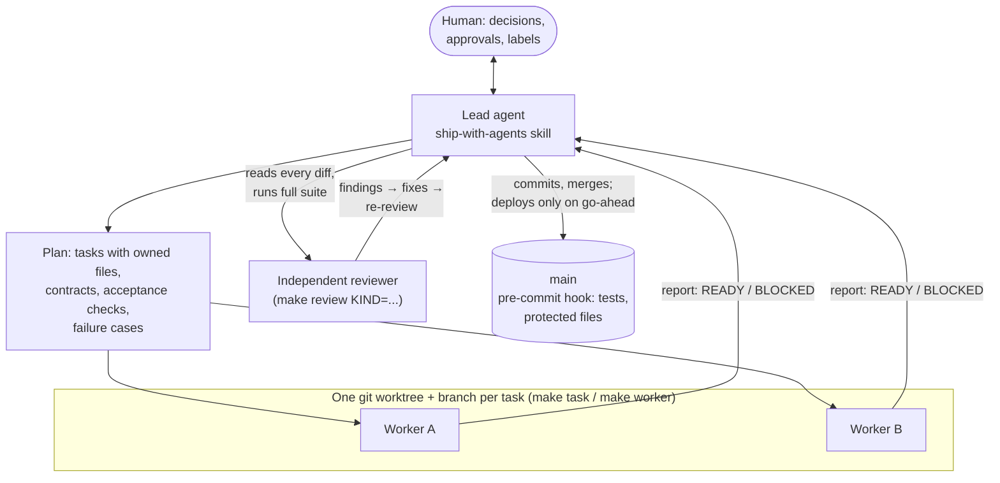

# agent-kit

A lightweight, harness- and model-agnostic starter kit that boots every project with shared agent instructions, enforceable code guardrails, and learned lessons from previous sessions — scaling cleanly from a single coding agent to a parallel team.

It works with Claude Code, Codex, pi, Gemini / Antigravity, Hermes, or any CLI via pluggable commands (`TEST_CMD`, `DEPLOY_CMD`, `REVIEW_CMD`, `WORKER_CMD`), and separates:
- a **tiny per-project template** (`template/`): lean `AGENTS.md` (< 3 KB), pre-commit hooks, explicit test outcomes, guarded deploys, and worktree/review scripts;
- **global skills** (`skills/`): linked once per machine (`install.sh --link-skills`) so improvements reach every project without copying heavy tooling into every repo.

It wasn't designed up front. It was extracted from real multi-agent builds — including [Crate Digger](https://github.com/ErikaLozada/crate-digger) and [reel-kit](https://github.com/ErikaLozada/reel-kit) — keeping what worked and turning recurring failures into code guards or short rules.

## Why this exists

Agents repeat the same predictable mistakes across projects unless rules live in shared files and code:
- lessons stay trapped in chat history or one harness's private memory;
- tests get skipped silently when a runtime is missing or no tests exist yet;
- evaluation labels or protected files get modified accidentally;
- deploys run from a dirty tree or unverified branch;
- a fix changes code without re-checking the original failing case;
- parallel agents edit the same files without contracts or independent review.

`agent-kit` answers each with a deterministic code guard where possible, and concise, harness-neutral rules everywhere else.

## Principles

- **What must always happen goes in code** (hooks, `make`). **Judgement goes in a skill.** **Project facts and rules go in `AGENTS.md`** — one file every harness reads, kept under 3 KB.
- **Harness- and model-agnostic:** no hardcoded vendor model IDs in project templates; configure your preferred tiers once in `~/.config/agent-kit/tiers.conf` or plug in any CLI.
- **One owner per fact & continuous learning:** capture session lessons with the `wrap-up` skill while context is hot, route each to its single owning file (`docs/decisions.md`, `AGENTS.md`, an external stack overlay, or `agent-kit`), and keep `template/` featherweight.
- **Explicit test outcomes:** missing required runtimes and empty suites fail; `NOT_EVALUATED` never masquerades as `PASS`; bootstrap commits (`ALLOW_NO_TESTS=1 git commit`) stay visible and can never deploy.

## What a project gets (`template/`)

`bash install.sh <folder> "<Name>"` works on new or existing folders, never overwrites an existing file, and never silently disables existing git hooks.

| File | Purpose |
| --- | --- |
| `AGENTS.md`, `CLAUDE.md` | Shared instructions for every harness, under 3 KB: commands, outside-the-repo rules, data, gates, defaults, working speed, conventions, glossary |
| `agent-kit.conf` | Project settings: `TEST_CMD`, `DEPLOY_CMD` / `SERVICE`, `HEALTH_URL`, `REVIEW_CMD`, `WORKER_CMD`, worktree `LINKS`/`OWN`, `PROTECTED` files |
| `Makefile` | `test`, `review`, `status`, `deploy`, `setup`, `task`, `worker`, `finish` |
| `.githooks/pre-commit` | Runs `make test` on every commit; blocks `PROTECTED` edits, enforces append-only `docs/decisions.md`, and scans staged diffs for secrets |
| `scripts/` | Explicit test runner, read-only headless / tabbed cross-agent review, guarded deploy, worktree task lifecycle, worker launcher, status |
| `docs/decisions.md` | Append-only decision log |
| `.agents/skills/ship-feature` | Project-local checklist for solo work or workers under a lead (`.claude/skills` symlinks to `.agents/skills`) |

## Global skills (`skills/`)

Run `bash install.sh --link-skills` once per machine to symlink `skills/*` into every installed harness (`~/.claude/skills`, `~/.agents/skills`, `~/.codex/skills`, `~/.gemini/config/skills`, `~/.pi/agent/skills`, `~/.hermes/skills`, plus optional `AGENT_SKILLS_DIRS`):

| Skill | Purpose |
| --- | --- |
| `new-project` | Runs `install.sh`, fills in `AGENTS.md` gates/defaults and `agent-kit.conf`, logs initial decisions |
| `wrap-up` | 2-minute end-of-session hygiene & lesson capture: checks git state, mines real friction, routes approved lessons to their one owning file |
| `ship-with-agents` | Lead orchestration for parallel work: plan with owned files & failure cases, start workers, relay prompts, cross-provider review, merge |
| `session-retro` | Quantitative retrospective from Claude Code, Codex, and pi transcripts, published as a Fern & Stone HTML page |
| `interactive-html-brief` | Turns long reviews, plans, and audits into Fern & Stone interactive HTML pages (Light default + Dark toggle) with single-prompt feedback export |
| `living-project-hub` | Multi-phase project & learning control center (progress tracks, execution/CLI log, Markdown library, frozen phase snapshots, feedback save-back) |

## Quick start

```sh
git clone https://github.com/ErikaLozada/agent-kit.git

# 1. Once per machine: link global skills into all installed harnesses
bash agent-kit/install.sh --link-skills

# 2. Start a new project (or adopt an existing folder safely)
bash agent-kit/install.sh ~/projects/my-project "My Project"

# Optional: layer a separate domain/stack overlay (e.g. your own private stack kit)
bash agent-kit/install.sh ~/projects/my-project "My Project" --overlay /path/to/my-overlay

# Optional: check an already-installed project for missing or customized kit files (read-only)
bash agent-kit/install.sh --check ~/projects/my-project
```

### Optional: Interactive HTML briefs across devices

`skills/interactive-html-brief` turns long agent reviews and plans into light-mode HTML pages you can annotate from a laptop, tablet, or phone over private Tailscale HTTPS and copy back as a single prompt. To enable the hardened local server + `publish-brief` CLI on Linux or macOS (zero hostnames committed to git), see [`skills/interactive-html-brief/README.md`](skills/interactive-html-brief/README.md):

```sh
bash agent-kit/install.sh --link-skills
bash agent-kit/skills/interactive-html-brief/scripts/setup-briefs-server.sh
```

## Scaling to parallel agents



Requirements: `git`, `bash`, and `python3` (Linux and macOS). [herdr](https://herdr.dev) and multiple agent CLIs are optional; without them, every script works cleanly with headless CLIs or your harness's native subagents. Run `make test` to verify the kit on your machine. Full details are in [`docs/guide.md`](docs/guide.md).

## Licence

[MIT](LICENSE)
