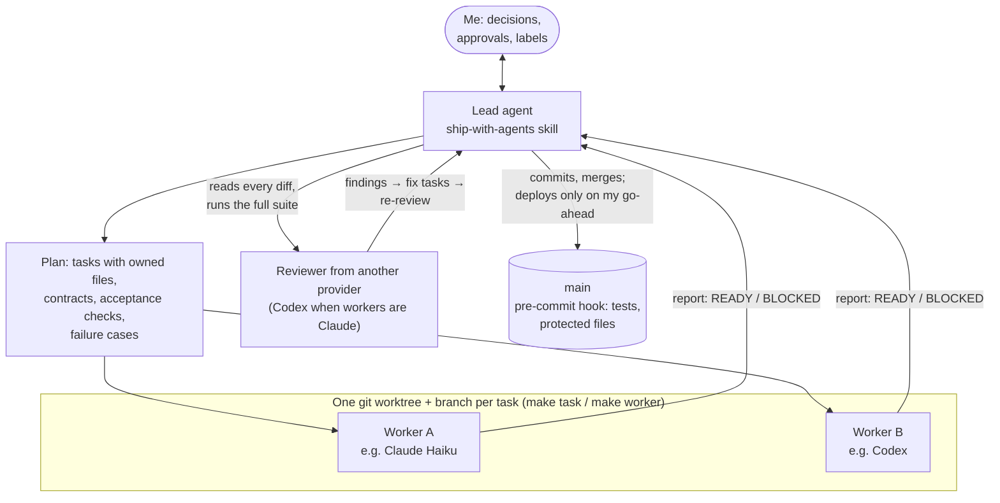

# agent-kit

A kit for running several AI coding agents on one project at the same time — Claude Code, OpenAI's Codex and pi — without them colliding, merging unreviewed work or deploying by accident. It has two parts:
- a **lead skill** that plans, briefs, reviews and commits;
- a **project template** of `make` commands, git hooks and shared instructions that turn the rules into code.

It wasn't designed up front. I extracted it from two real projects, keeping what worked and adding a guard for each thing that went wrong:
- [Crate Digger](https://github.com/ErikaLozada/crate-digger), a record-buying assistant built feature by feature by parallel agents;
- [reel-kit](https://github.com/ErikaLozada/reel-kit), a video pipeline whose code-review round ran 11 fixes in parallel.

## The problem

One agent is easy to supervise. Several at once fail in predictable ways:
- two of them edit the same file;
- a worker's tests pass, but the bug sits in a case its brief never mentioned;
- a fix is reported as done but only partly works;
- someone restarts the live service mid-task;
- an evaluation label quietly changes to fit the model's output;
- decisions vanish into chat history.

The kit answers each with a rule, and where possible with code that enforces the rule.

## How it works



- **The lead** (`skills/ship-with-agents`) learns each project's own commands and rules instead of assuming them. It writes one brief per task, naming the files it owns, its contract with the other tasks, the acceptance checks and the failure cases to test. It starts the workers, relays their permission prompts to me, reads every diff and runs the full suite. Workers never commit; the lead does.
- **Workers** each get their own git worktree, branch and test port (`make task`, `make worker`). The kit's scripts start Claude or Codex in its own terminal tab ([herdr](https://herdr.dev)) with permissions bounded to that worktree, and every message between agents is tagged with its sender.
- **A reviewer from another provider** reviews the plan and the merged work. It catches the lead's blind spots, including mistakes in the lead's own briefs. Then it re-reviews the fixes, because "the code changed" doesn't mean "fixed".
- **Hooks and scripts enforce what must always happen:**
  - the pre-commit hook runs the tests, and refuses changes to protected files, such as evaluation labels, unless I approve them;
  - `make deploy` refuses a dirty tree or failing tests, then health-checks the service and logs the commit;
  - `make status` shows what's live and every worktree's task and uncommitted changes.

## Principles

- **What must always happen goes in code** (hooks, `make`). **Steps that need judgement go in a skill.** **Facts and rules go in `AGENTS.md`**, one file every agent harness reads. It's kept short and grows from real mistakes.
- One worktree per task, one writer per shared file, and the contracts between tasks stated up front.
- One lead merges. Deploys happen only on the human's go-ahead.
- Results and status are generated by scripts, never copied by hand.
- Start with two agents, and scale to how fast the human can review.

## What it changed in practice

- **Cheaper models where the evidence allows.** In Crate Digger, finished tasks were replayed with cheaper worker models and graded against the reviewed result on five gates. Claude Haiku and Sonnet passed 6/6 and Codex luna 6/7, so routine tasks moved off the most expensive model ([replay results](https://github.com/ErikaLozada/crate-digger/blob/main/docs/tasks/replays.md)).
- **Bugs caught where tests couldn't.** Every bug stopped at the lead's review had passed the worker's own tests. That's why briefs now list failure cases, and why the lead reads every diff in full.
- **Partial fixes caught.** In reel-kit, the second review found two fixes that only partly worked. One was a lock check that ignored later edits; the other a filename collision that had just moved one step down the pipeline. Both became a planned follow-up task.
- **A list of lessons that grows.** Each project's "went wrong before" lessons go into the skill, so the next project starts with them. Examples: Codex reaching for screen control during a code review, sandboxed commands failing on sockets, worktrees missing untracked media.

## What a project gets

`bash install.sh <folder> "<Name>"` works on a new or existing folder and never overwrites a file. It adds:

| File | Purpose |
| --- | --- |
| `AGENTS.md`, `CLAUDE.md` | Shared instructions for every harness: commands, how it runs, data rules, how agents coordinate |
| `agent-kit.conf` | The project's service, health URL, test command, worktree links and protected files |
| `Makefile` | `test`, `status`, `deploy`, `task`, `worker`, `finish`, `report`, `setup` |
| `scripts/` | Worktree per task, worker start with bounded permissions, status, guarded deploy, a Codex watcher |
| `.githooks/pre-commit` | Tests on every commit; protected files need explicit approval |
| `docs/decisions.md` | An append-only decision log |
| `.agents/skills/ship-feature` | The worker's checklist, also used when working alone |

The kit tests itself: `make test` does a full install into a temporary project on Linux and macOS. It runs a task through to finish, checks the protected-file hook, port assignment, and the macOS fallbacks for the Linux-only tools `ss` and `systemd`.

## Quick start

```sh
git clone https://github.com/ErikaLozada/agent-kit.git
bash agent-kit/install.sh --link-skills                 # once per machine: links the skills into Claude Code, Codex and pi
bash agent-kit/install.sh ~/projects/my-project "My Project"
```

It needs git, bash and python3. herdr and the Codex CLI are optional; without them the lead uses Claude Code's own subagents. Details are in the [guide](docs/guide.md), and the kit's own plan and review rounds are in [`docs/`](docs/).

## Licence

[MIT](LICENSE)
