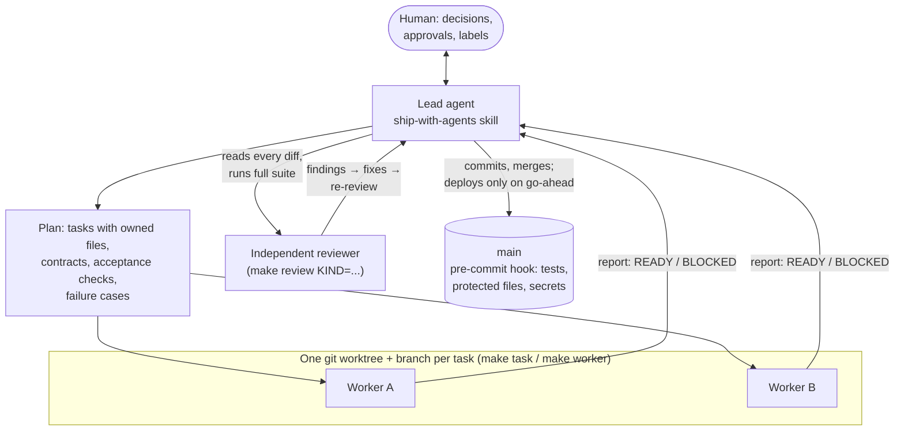

# agent-kit

A lightweight, harness- and model-agnostic starter kit that boots every project with shared agent instructions, enforceable code guardrails, and learned lessons from previous sessions — scaling cleanly from a single coding agent to a parallel team.

It works with Claude Code, Codex, pi, Gemini / Antigravity, Hermes, or any CLI via pluggable commands (`TEST_CMD`, `DEPLOY_CMD`, `REVIEW_CMD`, `WORKER_CMD`), and separates:
- a **tiny per-project template** (`template/`): lean `AGENTS.md` (< 3 KB), pre-commit hooks, explicit test outcomes, guarded deploys, and review/worktree scripts;
- **global skills** (`skills/`): linked once per machine (`install.sh --link-skills`) so improvements reach every project without copying heavy tooling into every repo.

Extracted from real multi-agent builds — including [Crate Digger](https://github.com/ErikaLozada/crate-digger) and [reel-kit](https://github.com/ErikaLozada/reel-kit) — turning recurring agent mistakes into deterministic code guards or concise rules.

---

## 1. One-time machine setup

Clone `agent-kit` **once**, anywhere you normally keep your repositories (it stays a standalone kit repo — do **not** clone it inside your project):

```sh
git clone https://github.com/ErikaLozada/agent-kit.git
cd agent-kit

# Link global skills into every installed harness
# (~/.claude, ~/.agents, ~/.codex, ~/.gemini/config, ~/.pi/agent, ~/.hermes + $AGENT_SKILLS_DIRS)
bash install.sh --link-skills

# Optional: verify the kit passes all self-tests on your machine (Linux or macOS)
make test
```

Optional one-time machine extras:
- **Personal worker model tiers** (keeps vendor model IDs out of project repos): create `~/.config/agent-kit/tiers.conf` — see [`skills/ship-with-agents/references/models.md`](skills/ship-with-agents/references/models.md).
- **Interactive HTML briefs across devices** (light/dark Fern & Stone briefs served privately over Tailscale HTTPS):
  ```sh
  bash skills/interactive-html-brief/scripts/setup-briefs-server.sh
  ```
  See [`skills/interactive-html-brief/README.md`](skills/interactive-html-brief/README.md) for Tailscale Serve & security setup.

---

## 2. Install into a new or existing project (Day-1 checklist)

`install.sh` copies the starter files **directly into the root of your project repository** (nothing is nested inside an `agent-kit/` or `projects/` subfolder). You can also ask any linked agent to run the **`new-project`** skill.

**Option A — Add to an existing repository (from your repo root):**
```sh
cd /path/to/your-repo
bash /path/to/agent-kit/install.sh .
# (Optional second argument sets the display name, e.g. install.sh . "My App"; defaults to the folder name)
```

**Option B — Create a brand-new repository from scratch:**
```sh
bash /path/to/agent-kit/install.sh /path/to/my-app "My App"
cd /path/to/my-app
```

*(Optional: append `--overlay /path/to/my-overlay` to either command to layer a separate domain/stack kit on top.)*

**What lands at the root of your repo:**
```text
my-app/
├── AGENTS.md                 # Shared rules for every agent (< 3 KB) — fill in your TODOs
├── CLAUDE.md                 # Imports @AGENTS.md
├── Makefile                  # make test / review / deploy / status / setup / task / worker / finish
├── agent-kit.conf            # Project config (TEST_CMD, DEPLOY_CMD, PROTECTED, LINKS/OWN)
├── .gitignore                # Ignores TASK.md, .reviews/, .scratch/, local caches & keys
├── .githooks/pre-commit      # Enforces tests, PROTECTED files, append-only decisions, secret scan
├── .agents/skills/           # Project-local ship-feature checklist (.claude/skills symlinks here)
├── docs/decisions.md         # Append-only decision log
└── scripts/                  # test.sh, review.sh, deploy.sh, status.sh, worktree/worker scripts
```

**Get going in 3 steps:**
```sh
# 1. Fill in AGENTS.md (< 3 KB: what it is, outside-the-repo rules, data/never-read, gates, defaults)
# 2. Configure agent-kit.conf (TEST_CMD, DEPLOY_CMD or SERVICE, PROTECTED, LINKS/OWN if multi-agent)
# 3. Make your baseline commit (if you have no tests yet, ALLOW_NO_TESTS=1 permits bootstrap as NOT_EVALUATED)
git add AGENTS.md CLAUDE.md Makefile agent-kit.conf .gitignore .githooks .agents .claude docs scripts
ALLOW_NO_TESTS=1 git commit -m "chore: bootstrap project with agent-kit"
```

When adopting an **existing repository**:
- `install.sh` **never overwrites** an existing file (it prints `kept ...` so you can merge `AGENTS.md`, `Makefile`, or `.gitignore` on your own terms).
- `install.sh` **never silently disables** an existing `core.hooksPath` or `.git/hooks/pre-commit` — run `make setup` to opt into `.githooks`, or chain `.githooks/pre-commit` from your existing hook.
- Check drift anytime (read-only): `bash /path/to/agent-kit/install.sh --check .` (from your repo root).

---

## 3. Command & shortcut cheat sheet

### Project `make` commands

| Command | What it does |
| --- | --- |
| `make test` | Runs `TEST_CMD`, or discovers Python (`tests/test_*.py`) and Node (`tests/*.test.*js`) suites with explicit `PASS` / `FAIL` / `SKIP` / `NOT_EVALUATED` outcomes |
| `make review KIND=codex\|claude\|pi\|gemini [BASE=ref] [MODEL=m]` | Runs an independent second-agent diff review (read-only in headless mode; repo-scoped tab inside `herdr`). Override with `REVIEW_CMD=...` or preview with `DRY=1` |
| `make deploy` | Deploys from a clean `main` branch only after `scripts/test.sh --require-tests` passes; runs `DEPLOY_CMD` (or `SERVICE` systemd restart), checks `HEALTH_URL`, logs to `.deploys.log` |
| `make setup` | Once per fresh clone: enables `.githooks/pre-commit` (`git config core.hooksPath .githooks`) |
| `make status` | Shows last deploy / service state and every active git worktree's branch, dirty count, and `TASK.md` owner/status |
| `make task NAME=<slug> [OWNER=<who>]` | Creates sibling worktree + branch, symlinks `LINKS` (skipping `OWN`), assigns a free `TEST_PORT`, and scaffolds `TASK.md` |
| `make worker NAME=<slug> TIER=simple\|medium\|complex` | Creates the task worktree and launches a bounded worker (reads `~/.config/agent-kit/tiers.conf`, or pass `KIND=... MODEL=... EFFORT=...`, or set `WORKER_CMD`, or `DRY=1`) |
| `make finish NAME=<slug>` | Removes a task's worktree and branch **only** after it is merged into `main` with no uncommitted tracked changes |
| `make diagram` | Rebuilds `docs/diagrams/*.html` and `docs/diagrams/README.md` from `scripts/diagrams.py` using the linked `feature-diagram` skill |

### Commit & installer shortcuts

| Shortcut / env flag | When to use |
| --- | --- |
| `ALLOW_NO_TESTS=1 git commit ...` | Initial scaffolding commit before any tests exist (reported `NOT_EVALUATED`, never `PASS`; never allowed on `make deploy`) |
| `USER_OK=1 git commit ...` | Human-approved edit to a `PROTECTED` file or an intentional rewrite of append-only `docs/decisions.md` |
| `ALLOW_SECRET_MATCH=1 git commit ...` | Explicit bypass if a synthetic test fixture triggers the pre-commit secret-pattern scanner |
| `DRY=1 make review ...` / `DRY=1 make worker ...` | Prints the exact commands that would run without launching an agent |
| `install.sh --link-skills` | Symlinks `skills/*` into all installed agent harnesses (rerun after `git pull`) |
| `install.sh --check <dir>` | Read-only drift report (`ok` / `customized` / `missing` / `project`) against `template/` |
| `install.sh <dir> "Name" --overlay <path-or-name>` | Layers an external domain/stack overlay (`AGENTS.append.md`, `.gitignore.append`, extra files) |

---

## 4. Which options to enable for your project

### Mode A — Solo / standard project (default)
Works out of the box with minimal config in `agent-kit.conf`:
1. Set `TEST_CMD` (or leave empty to auto-run `tests/test_*.py` and `tests/*.test.*js`; set `OPTIONAL_TEST_SUITES="javascript"` if a runtime is optional).
2. Set `DEPLOY_CMD` (any OS/stack: Docker, CLI, static host) or `SERVICE` (Linux `systemd --user`) + optional `HEALTH_URL`.
3. List human-only files (eval labels, golden fixtures, answer keys) in `PROTECTED="..."`.
4. Use **`make review KIND=<other-agent>`** before big merges, and run the **`wrap-up`** skill at the end of a workday to capture and route real lessons while context is fresh.

### Mode B — Multi-agent parallel workflow
Enable these options in `agent-kit.conf` + your machine config when running 2+ agents in parallel with the **`ship-with-agents`** lead skill:
1. **Worktree data sharing (`agent-kit.conf`):**
   - `LINKS="data/* .env"` — untracked files/folders each task worktree symlinks from main.
   - `OWN="data/live.json"` — subset of `LINKS` that each worktree keeps isolated (never shared with the live app).
   - `TEST_PORT=8001` and `TEST_SERVER="python3 -m http.server {PORT}"` — gives every worktree its own free port in `TASK.md`.
2. **Model tiers (`~/.config/agent-kit/tiers.conf`):** map `TIER_SIMPLE_*`, `TIER_MEDIUM_*`, `TIER_COMPLEX_*` to your preferred harnesses/models (or set `WORKER_CMD` / `REVIEW_CMD` in `agent-kit.conf` for custom CLIs).
3. **Agent channel:** Inside [herdr](https://herdr.dev) (`HERDR_ENV=1`), `make worker` and `make review` open dedicated tabs automatically. Outside herdr, `make worker` creates the isolated worktree and `make review` runs headless read-only.



### Mode C — Multi-phase / GSD projects (`.planning/`)
`agent-kit` stays decoupled from any specific planning framework, and pairs cleanly with multi-phase planners like **`gsd-core`** when building large projects from scratch with cross-stage dependencies:
- **When to add GSD:** Multi-phase builds with ordered dependencies, early assumption probes, and multi-day state tracking (`.planning/STATE.md`, `ROADMAP.md`, wave plans). Skip GSD for small tools, prototypes, or single-feature changes where `agent-kit` + `ship-feature` is much faster.
- **What to enable alongside GSD:**
  1. **Keep local planner/tool caches out of Git:** `template/.gitignore` already ignores `.scratch/` and `.claude/settings.local.json`; add any repo-local generated agent folders you don't want committed and stage explicit paths (avoid blind `git add -A`).
  2. **Enable the unified Living Project & Learning Hub (`living-project-hub` skill):** one background server + Projects Index for **all** repos on your machine (auto-discovers `.planning/`, `docs/`, and `.scratch/execution-log.json`):
     ```sh
     # Once per machine (serves all registered projects on one port; optional Tailscale HTTPS on :8445)
     bash /path/to/agent-kit/skills/living-project-hub/scripts/setup-hub-server.sh

     # Inside any project repo: build hub & register it into the shared Projects Index
     build-project-hub --register
     build-project-hub --snapshot phase-01-init --register   # freeze phase snapshot
     ```
  3. **Capture lessons continuously:** Run **`wrap-up`** at the end of a session to distill traps from `.scratch/execution-log.json` into `AGENTS.md` / `docs/decisions.md` / overlays; run **`session-retro`** at major milestones for full transcript timing analysis.

### Mode D — Stack / domain overlays (`--overlay`)
Keep `agent-kit` 100% generic. Put stack- or domain-specific rules in a separate folder or repo (default search path: `~/.config/agent-kit/overlays/<name>`, or pass any directory path):
```text
my-stack-overlay/
  STACK.md             # copied into the project (supports {{PROJECT}} and {{DATE}})
  AGENTS.append.md     # idempotently appended to AGENTS.md with an overlay marker
  .gitignore.append    # lines merged idempotently into .gitignore
```
Install with: `bash /path/to/agent-kit/install.sh . --overlay /path/to/my-stack-overlay` (or target a new repo path).

---

## 5. What is included

### Per-project template (`template/`)

| File | Purpose |
| --- | --- |
| `AGENTS.md`, `CLAUDE.md` | Shared instructions for every harness (< 3 KB): commands, outside-the-repo rules, data, gates, defaults, working speed, conventions, glossary |
| `agent-kit.conf` | Project settings: `TEST_CMD`, `DEPLOY_CMD` / `SERVICE`, `HEALTH_URL`, `REVIEW_CMD`, `WORKER_CMD`, worktree `LINKS`/`OWN`, `PROTECTED` files |
| `Makefile` | `test`, `review`, `status`, `deploy`, `setup`, `task`, `worker`, `finish`, `diagram` |
| `.githooks/pre-commit` | Runs `make test`, guards `PROTECTED` files, enforces append-only `docs/decisions.md`, and scans staged diffs for secrets (filenames/counts only) |
| `scripts/` | Explicit test runner, read-only headless / tabbed review, guarded deploy, worktree lifecycle, tier-configurable worker launcher, status |
| `docs/decisions.md` | Append-only decision log |
| `.agents/skills/ship-feature` | Project-local checklist for solo work or workers under a lead (`.claude/skills` symlinks to `.agents/skills`) |

### Global skills (`skills/`, linked via `--link-skills`)

| Skill | Purpose |
| --- | --- |
| `new-project` | Runs `install.sh`, fills in `AGENTS.md` gates/defaults and `agent-kit.conf`, logs initial decisions |
| `wrap-up` | 2-minute end-of-session hygiene & lesson capture: checks git state, mines session friction, routes approved lessons to their one owning file |
| `ship-with-agents` | Lead orchestration for parallel work: plan with owned files & failure cases, start workers, relay prompts, cross-provider review, merge |
| `session-retro` | Quantitative retrospective from Claude Code, Codex, and pi transcripts, published as a Fern & Stone HTML page |
| `interactive-html-brief` | Turns long reviews, plans, and audits into Fern & Stone interactive HTML pages (Light default + Dark toggle) with single-prompt feedback export and inline embedded diagrams |
| `feature-diagram` | Generates byte-stable, self-contained Fern & Stone HTML flow diagrams (`make diagram`) reading thresholds/results from code, plus inline blocks for briefs |
| `living-project-hub` | Multi-phase project & learning control center (progress tracks, execution/CLI log, Markdown library, frozen phase snapshots, feedback save-back) |

---

## Principles & requirements

- **Code enforces invariants; skills hold judgement; `AGENTS.md` holds concise project rules (< 3 KB).**
- **One owner per fact:** rules in `AGENTS.md`, choices in `docs/decisions.md`, stack rules in overlays, universal workflows in `agent-kit`.
- **Requirements:** `git`, `bash`, and `python3` (Linux and macOS). [herdr](https://herdr.dev) and multiple agent CLIs are optional. Full details in [`docs/guide.md`](docs/guide.md).

## Licence

[MIT](LICENSE)
